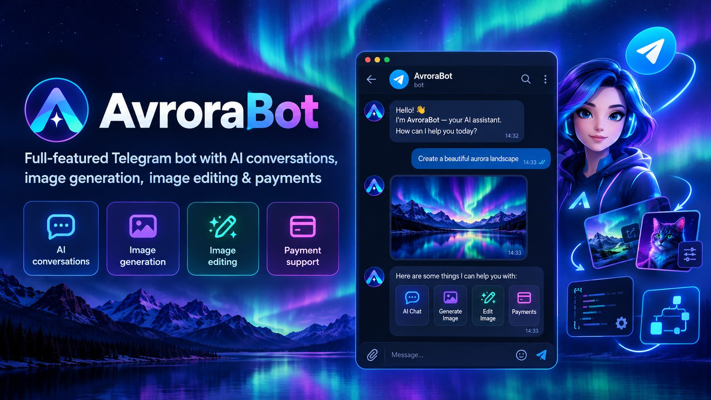

# AvroraBot

## Getting Started

To start the bot you have to provide the following settings, either as an `.env` file or as environment variables:

```
Telegram: ""
Mongo: ""
OpenAi: ""
```

| Key        | Description                                                        |
|------------|--------------------------------------------------------------------|
| `Telegram` | Telegram Bot API token (get it from [@BotFather](https://t.me/BotFather)) |
| `Mongo`    | MongoDB connection string                                          |
| `OpenAi`   | OpenAI API key                                                     |

You also have to **run a MongoDB instance** before starting the bot.

> **Note:** The bot uses MongoDB transactions to keep data consistent. Transactions require MongoDB to run as a **replica set** (a single-node replica set is enough for local development).

Example of a local connection string:

```
Mongo: "mongodb://localhost:27017/?replicaSet=rs0"
```

## Overview

AvroraBot is a Telegram chatbot with AI conversations, image generation, and image editing.

- 💬 **AI conversations**: chat with the bot in natural language
- 🎨 **Image generation**: create images from text prompts
- 🖌️ **Image editing**: edit images by sending a picture and a description of the changes

## Business Features

AvroraBot is a full-featured business solution:

- 💳 **Payments**: built-in payment support for purchasing bundles
- 📊 **User usage tracking**: tracks how much each user uses the bot's services (conversations, image generation, image editing)
- 🎁 **Tiered service bundles**: several bundles provide different levels of access to the bot's services

## Architecture

The solution follows Domain-Driven Design (DDD) principles and is split into four layers:

| Layer            | Role                                                                                      |
|------------------|-------------------------------------------------------------------------------------------|
| `TelegramBot`    | **Presentation layer**: receives Telegram updates, handles commands, messages and replies |
| `Application`    | **Application layer**: use cases and orchestration of business operations                 |
| `Core`           | Core domain and database model, persisted in MongoDB                                      |
| `Infrastructure` | External integrations and implementations (MongoDB access, OpenAI, payments)             |

Data is stored in **MongoDB** with **transaction support**, which guarantees integrity for operations such as payments and usage tracking.
